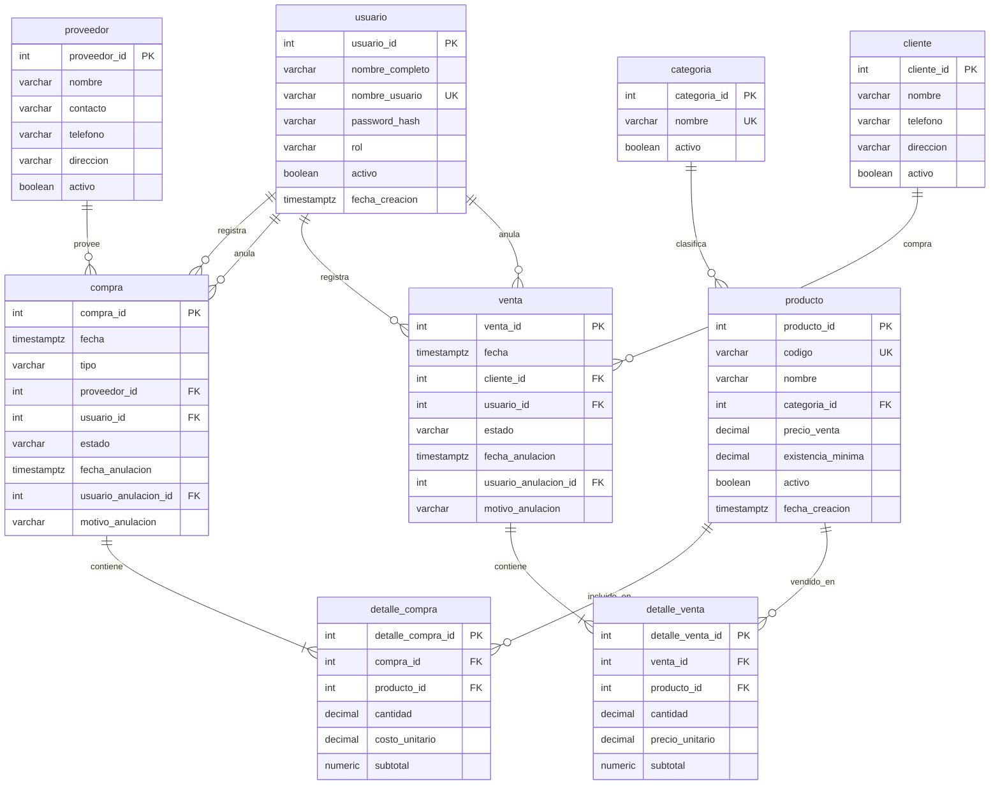
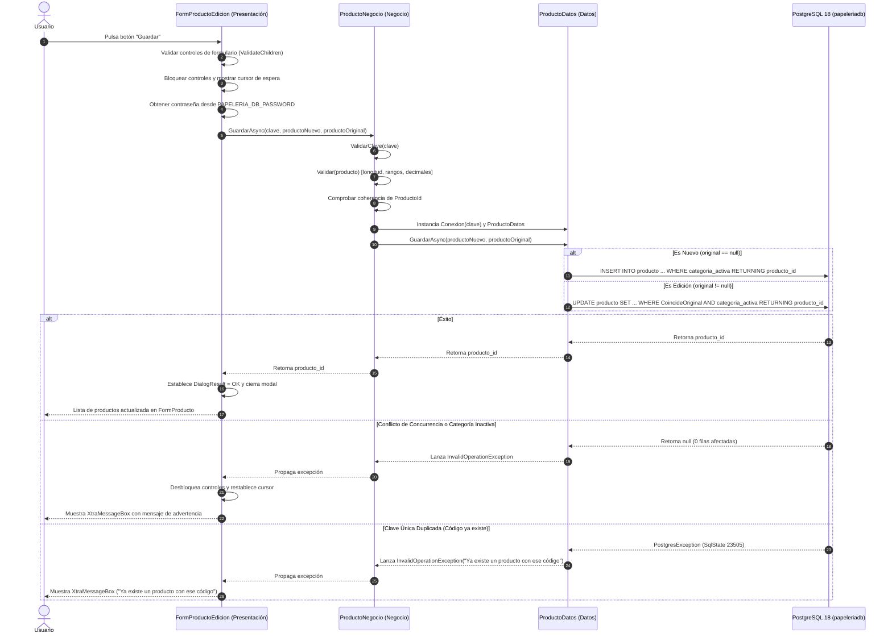

# Análisis Exhaustivo de Arquitectura, Flujo y Base de Código
## Proyecto: Sistema Papelería (C#, .NET 8, PostgreSQL, DevExpress)

---

## 1. Resumen Ejecutivo del Proyecto

El **Sistema Papelería** es una aplicación de escritorio corporativa desarrollada bajo la plataforma **.NET 8 (Windows Forms)** con componentes de interfaz de usuario de alta fidelidad (**DevExpress 26.1**) y una base de datos relacional robusta en **PostgreSQL**.

El propósito fundamental del sistema es la administración integral de una papelería (inventario, catálogo de productos, compras, ventas, clientes, proveedores y control de usuarios), implementando un diseño de software basado en una **arquitectura en cuatro capas estrictamente desacopladas y unidireccionales**.

### Ficha Técnica
- **Lenguaje:** C# 12 / .NET 8.0 (`net8.0` y `net8.0-windows`).
- **Patrón de Arquitectura:** N-Capas (4 capas clásicas de software empresarial: Entidades, Datos, Negocio, Presentación).
- **Base de Datos:** PostgreSQL 18 (`papeleriadb`), esquema `public`, driver ADO.NET de alto rendimiento `Npgsql 10.0.3`.
- **Librería de Interfaz:** DevExpress WinForms (`DevExpress.Win.Design 26.1.5`).
- **Seguridad de Credenciales:** Inyección en tiempo de ejecución mediante variables de entorno a nivel de usuario (`PAPELERIA_DB_PASSWORD`).
- **Gestión de Concurrencia:** Concurrencia optimista estricta mediante comprobación de estado original (`CoincideOriginal`).

---

## 2. Arquitectura del Sistema (N-Capas Desacopladas)

El sistema sigue una jerarquía de dependencias unidireccionales donde las capas superiores consumen las inferiores, manteniendo la capa de **Entidades** como núcleo transversal común y libre de dependencias.

```
       ┌────────────────────────┐
       │ Papeleria.Presentacion │  (UI: Windows Forms + DevExpress)
       └───────────┬────────────┘
                   │ Referencia a Negocio y Entidades
                   ▼
       ┌────────────────────────┐
       │   Papeleria.Negocio    │  (Validaciones de Dominio y Reglas)
       └───────────┬────────────┘
                   │ Referencia a Datos y Entidades
                   ▼
       ┌────────────────────────┐
       │    Papeleria.Datos     │  (Persistencia SQL con Npgsql)
       └───────────┬────────────┘
                   │ Referencia a Entidades
                   ▼
┌────────────────────────────────────────────────────────┐
│                  Papeleria.Entidades                   │  (Modelos POCO limpios)
└────────────────────────────────────────────────────────┘
```

### Reglas de Dependencia y Responsabilidades

| Capa | Proyecto | Responsabilidad Clave | Dependencias |
| :--- | :--- | :--- | :--- |
| **1. Entidades** | `Papeleria.Entidades.csproj` | Clases POCO (Plain Old CLR Objects) que modelan los datos de negocio. No contiene lógica de base de datos ni validaciones complejas. | Ninguna (cero dependencias externas). |
| **2. Datos** | `Papeleria.Datos.csproj` | Acceso a datos crudo y optimizado vía ADO.NET con `Npgsql`. Construcción y parametrización de comandos SQL, mapeo de `NpgsqlDataReader` a objetos, control de concurrencia y excepciones de base de datos. | `Papeleria.Entidades`, paquete `Npgsql`. |
| **3. Negocio** | `Papeleria.Negocio.csproj` | Orquestación, validación de reglas de dominio (rangos de precios, longitudes, obligatoriedad), gestión del ciclo de vida de la conexión y puente entre la UI y los Datos. | `Papeleria.Datos`, `Papeleria.Entidades`. |
| **4. Presentación** | `Papeleria.Presentacion.csproj` | Formularios Windows Forms y controles DevExpress (`GridControl`, `GridView`, `SpinEdit`, `LookUpEdit`). Captura de eventos, experiencia de usuario asíncrona, formateo visual y captura de errores amigables. | `Papeleria.Negocio`, `Papeleria.Entidades`, paquete `DevExpress.Win.Design`. |

---

## 3. Estructura del Código y Componentes

### 3.1. Proyectos de la Solución (`Sistema Papeleria.sln`)

#### A. `Papeleria.Entidades`
- **`Producto.cs`**:
  - Propiedades: `ProductoId` (int), `Codigo` (string, max 30), `Nombre` (string, max 150), `CategoriaId` (int), `PrecioVenta` (decimal 18,2), `ExistenciaMinima` (decimal 18,3), `Activo` (bool), `FechaCreacion` (DateTime en UTC).
  - Objeto de transporte puro (DTO/Entidad de dominio).
- **`Categoria.cs`**:
  - Propiedades: `CategoriaId` (int), `Nombre` (string, max 80), `Activo` (bool).
  - Propiedad calculada: `Descripcion => Activo ? Nombre : Nombre + " (inactiva)"` para visualización clara en combos desplegables (`LookUpEdit`).

#### B. `Papeleria.Datos`
- **`Conexion.cs`**:
  - Implementa `IDisposable`.
  - Encapsula `NpgsqlDataSource` optimizado para pooling de conexiones.
  - Genera la cadena de conexión dinámica: host `localhost`, puerto `5432`, base `papeleriadb`, usuario `postgres`, timeouts de 5 segundos.
  - Expone el método `internal NpgsqlCommand CrearComando(string sql)` para centralizar la creación de comandos dentro del ensamblado.
  - Proporciona `ProbarConexionAsync()` (`SELECT current_database();`).
- **`ProductoDatos.cs`**:
  - Constructor con inyección de `Conexion`.
  - **`ListarAsync()`**: Ejecuta `SELECT producto_id, codigo, nombre, categoria_id, precio_venta, existencia_minima, activo, fecha_creacion FROM public.producto ORDER BY codigo, producto_id` y mapea asíncronamente con `await lector.ReadAsync()`.
  - **`ListarCategoriasAsync()`**: Consulta `SELECT categoria_id, nombre, activo FROM public.categoria ORDER BY nombre`.
  - **`GuardarAsync(Producto p, Producto? original)`**:
    - Si `original == null`: Realiza un `INSERT INTO public.producto ... RETURNING producto_id` condicionado a que la categoría esté activa (`EXISTS (SELECT 1 FROM public.categoria c WHERE c.categoria_id = @cat AND (c.activo OR c.categoria_id = @anterior))`).
    - Si `original != null`: Realiza un `UPDATE public.producto SET ... WHERE CoincideOriginal AND categoriaValida RETURNING producto_id`.
    - Atrapa códigos de error específicos de PostgreSQL:
      - `23505` (violación de unicidad / UNIQUE constraint): Notifica código duplicado.
      - `23503` (violación de clave foránea / FK constraint): Notifica categoría inexistente.
  - **`EliminarAsync(Producto original)`**:
    - Ejecuta `DELETE FROM public.producto WHERE CoincideOriginal`.
    - Si las filas afectadas no son exactamente 1, lanza excepción de concurrencia.
    - Atrapa el código `23503` (FK violation): Avisa si el producto ya cuenta con registros relacionados en compras o ventas y sugiere desactivarlo en lugar de borrarlo.

#### C. `Papeleria.Negocio`
- **`ConexionNegocio.cs`**:
  - Método `ProbarAsync(string clave)`: Instancia `Conexion` dentro de un bloque `using` seguro para verificar el acceso y liberar los recursos de red inmediatamente.
- **`ProductoNegocio.cs`**:
  - **`ValidarClave(string clave)`**: Garantiza que la contraseña no venga vacía antes de tocar la red.
  - **`Validar(Producto p)`**: Valida reglas de dominio independientes de la UI:
    - Longitud de código entre 1 y 30 caracteres.
    - Longitud de nombre entre 1 y 150 caracteres.
    - `CategoriaId > 0`.
    - `PrecioVenta` no negativo, máximo `9999999999999999.99` y redondeado exactamente a 2 decimales.
    - `ExistenciaMinima` no negativa, máximo `999999999999999.999` y redondeada a 3 decimales.
  - **`ListarAsync(string clave)`**: Orquesta conexión y consulta de productos.
  - **`ListarCategoriasAsync(string clave)`**: Orquesta consulta de categorías.
  - **`GuardarAsync(string clave, Producto p, Producto? original)`**: Valida clave, valida entidad, valida coherencia de IDs entre el original y el modificado, y persiste.
  - **`EliminarAsync(string clave, Producto original)`**: Valida identificador y ejecuta borrado con control de concurrencia.

#### D. `Papeleria.Presentacion`
- **`Program.cs`**: Punto de entrada STAThread, inicializa `ApplicationConfiguration` y lanza `Form1`.
- **`Form1.cs` & `Form1.Designer.cs`**:
  - Formulario inicial de control y diagnóstico.
  - Botón **Test de conexión**: Comprueba de forma asíncrona la conectividad leyendo `PAPELERIA_DB_PASSWORD` de las variables de entorno de Windows (nivel Usuario), deshabilitando la UI durante la prueba para evitar reentrancias.
  - Botón **Abrir productos**: Lanza de forma modal `FormProducto`.
- **`FormProducto.cs` & `FormProducto.Designer.cs`**:
  - Formulario principal del catálogo de productos basado en DevExpress `XtraForm`.
  - Controles: `GridControl` (`gridProductos`), `GridView` (`vistaProductos`), botones de acción (**Nuevo**, **Editar**, **Eliminar**, **Actualizar**) y `LabelControl` (`lblEstado`).
  - Configuración programática de columnas DevExpress: formatos numéricos (`n2` para precio, `n3` para existencia mínima), formato de fecha UTC (`dd/MM/yyyy HH:mm`), anchuras y visibilidad.
  - Gestión de estado: bandera `_cargando`, cursor de espera (`UseWaitCursor`), desactivación masiva de botones durante operaciones I/O y bloqueo de cierre accidental durante peticiones en vuelo.
  - Búsqueda y filtrado integrados mediante el motor nativo de DevExpress `FindFilterText`.
- **`FormProductoEdicion.cs`**:
  - Formulario modal creado 100% por código C# (sin archivo `.Designer.cs` acoplado), lo que garantiza portabilidad y mantenimiento limpio.
  - Soporte de alta resolución y escalado DPI (`AutoScaleMode = AutoScaleMode.Dpi; AutoScaleDimensions = new SizeF(96, 96);`).
  - Controles DevExpress: `TextEdit` (código y nombre), `LookUpEdit` (categoría activa o actual), `SpinEdit` (máscaras y límites numéricos), `CheckEdit` (activo/inactivo), `SimpleButton` (guardar y cancelar).
  - Aislamiento de datos: Trabaja sobre una copia de la entidad, jamás sobre la fila enlazada en el grid.
  - Detección de cambios no guardados (`_cambio`): Advierte al usuario al intentar cerrar el formulario con modificaciones pendientes.

---

## 4. Base de Datos PostgreSQL y Modelo Relacional

El proyecto cuenta con 3 scripts SQL ubicados en `scripts/`:
1. `00_Papeleria_PostgreSQL_CrearBase.sql`: Crea la base de datos `papeleriadb`.
2. `01_Papeleria_PostgreSQL_Estructura.sql`: Crea 9 tablas, 11 claves foráneas, índices optimizados y 6 vistas.
3. `02_Papeleria_PostgreSQL_DatosPrueba.sql`: Carga masiva de 6,501 registros de prueba para pruebas de rendimiento y estrés.

### 4.1. Diagrama Entidad-Relación y Tablas



### 4.2. Características Destacadas del Modelo de Datos
- **Columnas Generadas (`GENERATED ALWAYS AS ... STORED`)**: En `detalle_compra` y `detalle_venta`, el subtotal se calcula a nivel de motor: `round(cantidad * costo_unitario, 2)`.
- **Identidad Auto-incremental Estricta**: Uso de `generated always as identity not null`, evitando inserciones arbitrarias de llaves primarias.
- **Índices Únicos Case-Insensitive**: `CREATE UNIQUE INDEX uq_producto_codigo ON public.producto (lower(codigo));` para evitar duplicidad por mayúsculas/minúsculas.
- **Vistas de Negocio Optimizadas**:
  - `vw_inventario`: Calcula en tiempo real las existencias netas (`compras CONFIRMADAS - ventas CONFIRMADAS`).
  - `vw_productos_bajo_minimo`: Filtra productos cuya existencia actual sea menor o igual a la `existencia_minima`.
  - `vw_total_ventas` y `vw_total_compras`: Agregaciones de totales por documento.
  - `vw_ventas_por_dia`: Agrupación cronológica por fecha UTC.
  - `vw_productos_mas_vendidos`: Análisis de rotación de productos.

---

## 5. Flujo Operativo y de Datos de Extremo a Extremo

A continuación se ilustra el flujo de una operación típica del sistema, tomando como ejemplo **Guardar un Producto (Nuevo o Edición)**:



---

## 6. Patrones de Diseño y Mecanismos Clave de Ingeniería

### 6.1. Gestión Segura de Credenciales (Zero Hardcoding)
En lugar de almacenar credenciales en archivos `app.config`, `appsettings.json` o constantes en código C#, la aplicación requiere la variable de entorno a nivel de usuario:
```csharp
string? clave = Environment.GetEnvironmentVariable("PAPELERIA_DB_PASSWORD", EnvironmentVariableTarget.User);
```
Esto garantiza que ni repositorios Git públicos ni binarios compilados expongan credenciales de base de datos.

### 6.2. Concurrencia Optimista Estricta (`CoincideOriginal`)
Para evitar que dos operadores sobreescriban los datos del otro (escritura sucia o pérdida de actualizaciones), el comando `UPDATE` y `DELETE` compara **todas** las columnas del registro con su estado cuando fue cargado en memoria:
```csharp
private const string CoincideOriginal = """
    producto_id = @id AND codigo = @oc AND nombre = @on
    AND categoria_id = @ocat AND precio_venta = @op
    AND existencia_minima = @om AND activo = @oa AND fecha_creacion = @of
    """;
```
Si otro usuario modificó cualquier campo mientras el operador tenía el formulario abierto, el `UPDATE` no actualiza ninguna fila y el sistema rechaza la operación protegiendo la consistencia de la información.

### 6.3. Manejo de Excepciones y Códigos de Estado PostgreSQL
La capa de datos mapea excepciones de bajo nivel a errores comprensibles para el usuario de negocio:
- **`23505`**: `unique_violation` $\rightarrow$ "Ya existe un producto con ese código."
- **`23503`**: `foreign_key_violation` $\rightarrow$ "Este producto tiene movimientos asociados. Puede desactivarlo desde Editar." o "La categoría ya no existe."

### 6.4. Asincronía Total de Entrada/Salida (I/O Bound)
Toda la comunicación de red con PostgreSQL se implementa utilizando `async/await` (`ExecuteReaderAsync()`, `ExecuteScalarAsync()`, `ExecuteNonQueryAsync()`, `ReadAsync()`), garantizando que la interfaz gráfica (UI Thread) nunca se congele, incluso al procesar miles de registros.

---

## 7. Estado Actual del Software vs. Alcance de la Base de Datos

El diseño del esquema en base de datos prevé un ERP completo de papelería, del cual la aplicación actual tiene implementada la fase base:

| Módulo / Dominio | Estado en Base de Datos (`01_Estructura.sql`) | Estado en Código C# (.NET 8) |
| :--- | :--- | :--- |
| **Prueba de Conexión** | ✅ Implementado | ✅ Completo (`Conexion`, `Form1`) |
| **Categorías** | ✅ Tabla `categoria` con restricciones | ✅ Lectura y enlace a productos |
| **Productos** | ✅ Tabla `producto` con índices y checks | ✅ CRUD completo con DevExpress |
| **Clientes** | ✅ Tabla `cliente` | ⏳ Pendiente de capas C# y UI |
| **Proveedores** | ✅ Tabla `proveedor` | ⏳ Pendiente de capas C# y UI |
| **Usuarios y Roles** | ✅ Tabla `usuario` con password_hash y roles | ⏳ Pendiente de capas C# y UI (Login) |
| **Compras / Inventario Inicial** | ✅ Tablas `compra` y `detalle_compra` | ⏳ Pendiente de capas C# y UI |
| **Ventas / Facturación** | ✅ Tablas `venta` y `detalle_venta` | ⏳ Pendiente de capas C# y UI |
| **Vistas e Informes** | ✅ 6 Vistas SQL de saldo y rotación | ⏳ Pendiente de capas C# y UI |

---

## 8. Guía / Blueprint para Replicar este Estilo en un Nuevo Proyecto

Para desarrollar un nuevo proyecto bajo este mismo estándar y calidad:

1. **Definir el Modelo Relacional en SQL**:
   - Tablas con llaves primarias `generated always as identity`.
   - Índices únicos `lower(campo)` para texto único.
   - Columnas calculadas automáticas (`generated always as (...) stored`).
   - Sin borrados en cascada para preservar auditoría histórica.
2. **Crear la Solución .NET**:
   - `dotnet new sln -n <Proyecto>`
   - `dotnet new classlib -n <Proyecto>.Entidades -f net8.0`
   - `dotnet new classlib -n <Proyecto>.Datos -f net8.0` (instalar `Npgsql`)
   - `dotnet new classlib -n <Proyecto>.Negocio -f net8.0`
   - `dotnet new winforms -n <Proyecto>.Presentacion -f net8.0-windows` (instalar `DevExpress.Win.Design`)
3. **Establecer Referencias Unidireccionales**:
   - `Presentacion` $\rightarrow$ `Negocio`, `Entidades`
   - `Negocio` $\rightarrow$ `Datos`, `Entidades`
   - `Datos` $\rightarrow$ `Entidades`
   - `Entidades` $\rightarrow$ (sin referencias)
4. **Implementar Patrón de Conexión Eficiente**:
   - `NpgsqlDataSource` con `IDisposable`.
   - Credenciales mediante variables de entorno del sistema.
5. **Implementar CRUD con Concurrencia Optimista**:
   - Mapeo manual limpio con `NpgsqlDataReader`.
   - Verificación de estado original en sentencias `UPDATE` y `DELETE`.
   - Manejo de códigos SQL `23505` y `23503`.
6. **Diseñar UI de Alta Calidad**:
   - Formularios desacoplados, código limpio con soporte DPI.
   - Componentes DevExpress configurados para formateo y filtrado en caliente.